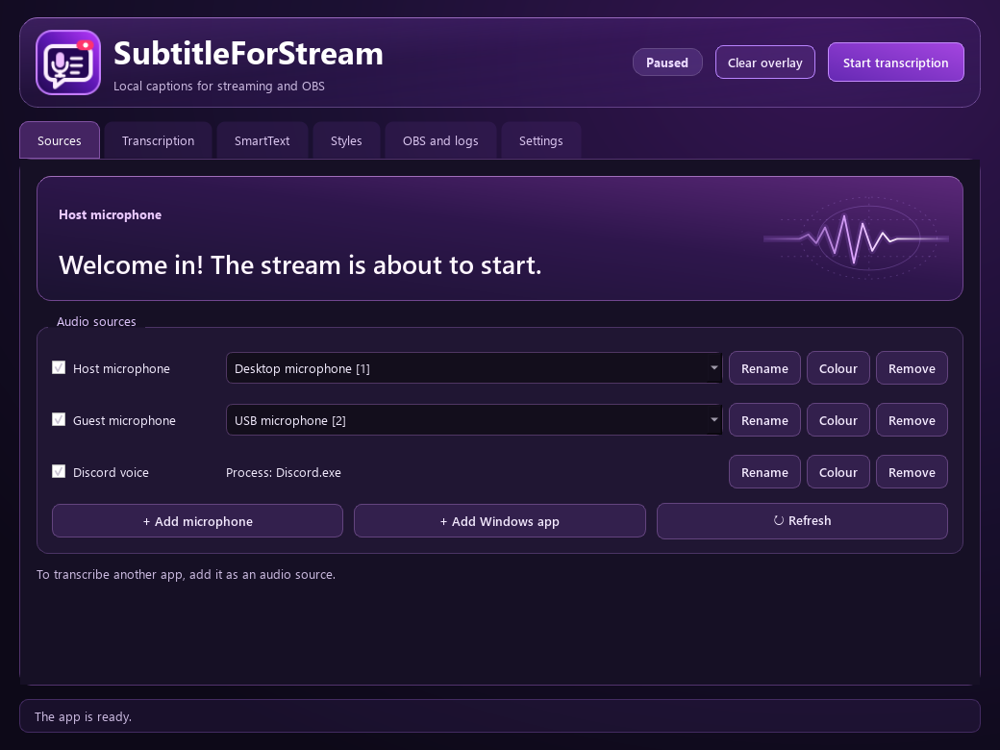
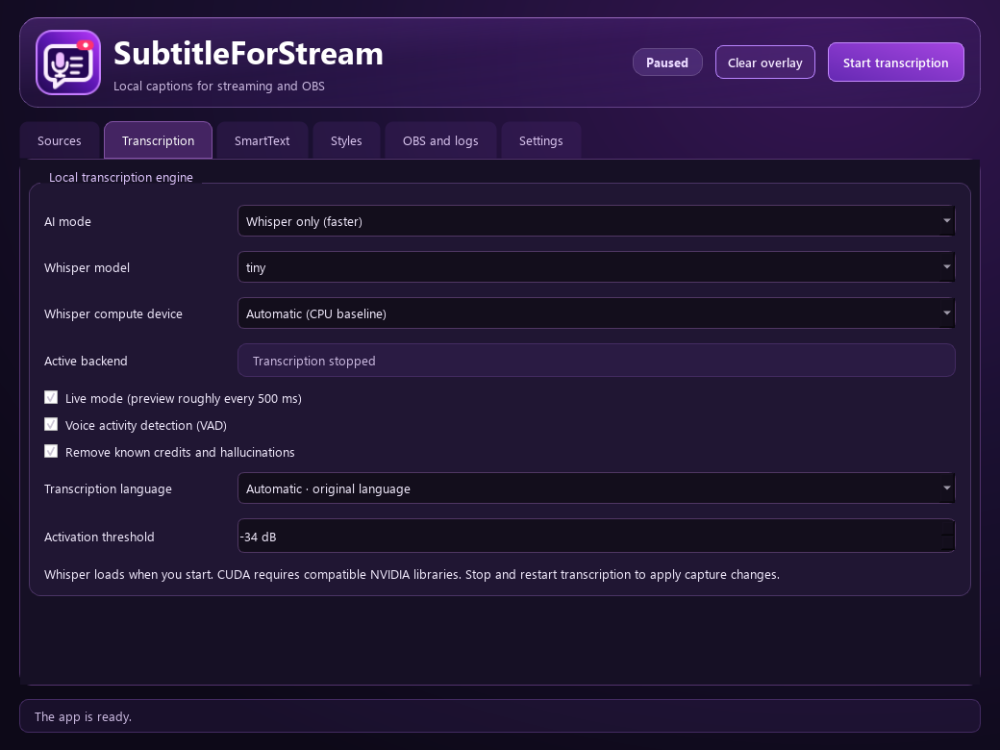
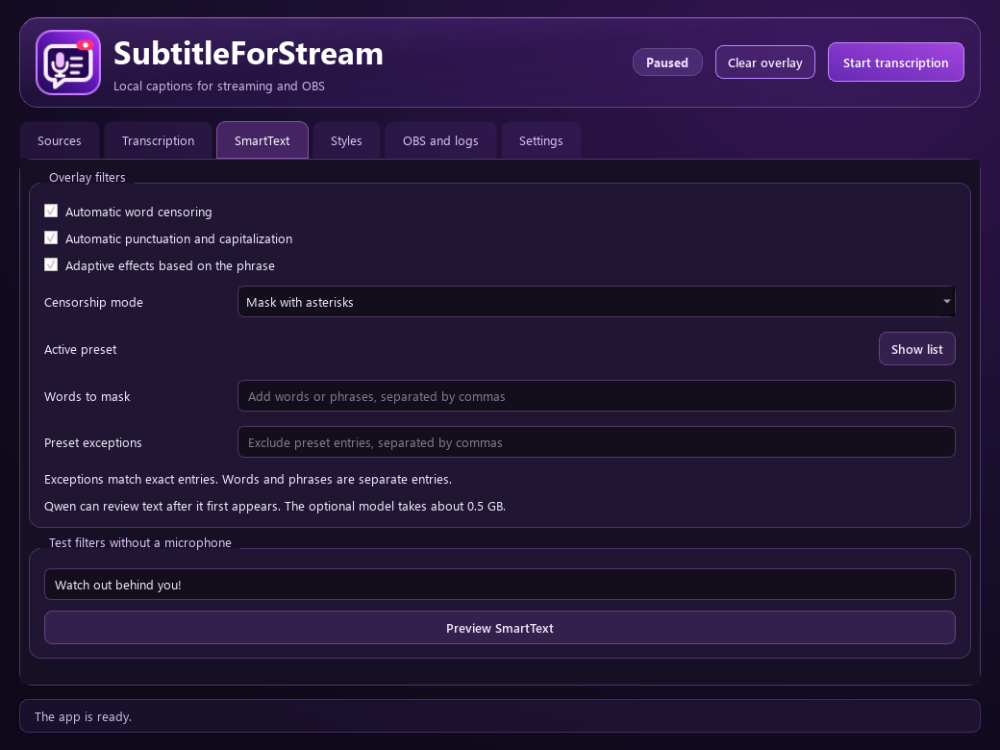
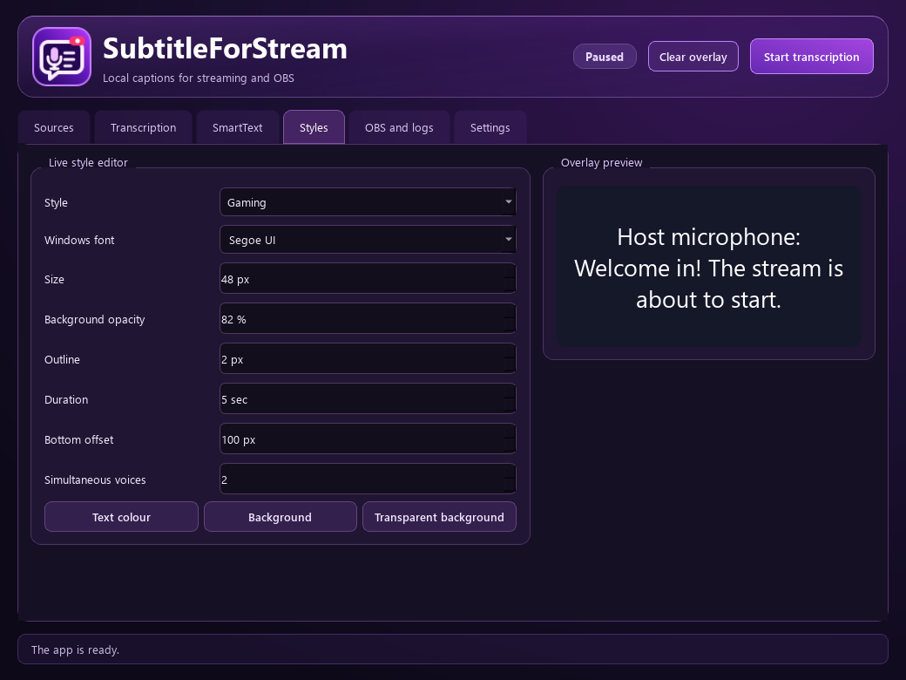
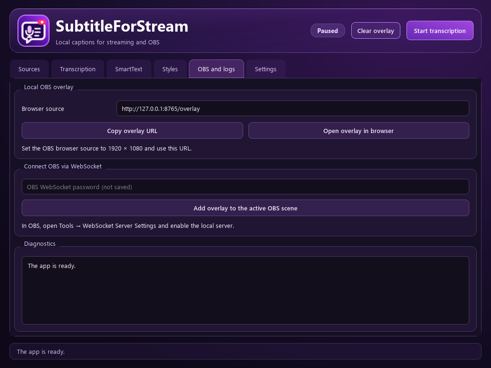
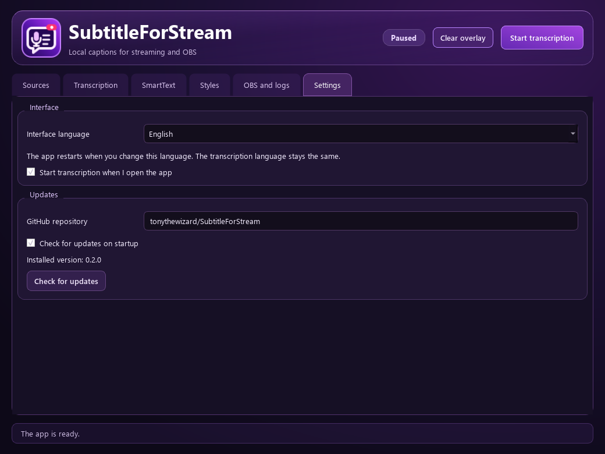
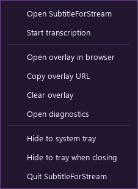

# SubtitleForStream

**Live captions for streamers and OBS on Windows.** SubtitleForStream listens to microphones and selected Windows applications, transcribes speech locally with Whisper, and serves a transparent browser overlay for OBS. It can label each audio source separately, so viewers can tell the host microphone from a guest microphone or Discord.



- [Get started](#get-started)
- [Capture and transcription](#capture-and-transcription)
- [SmartText and overlay styles](#smarttext-and-overlay-styles)
- [Set up OBS](#set-up-obs)
- [Settings, tray and updates](#settings-tray-and-updates)
- [Compatibility](#compatibility)
- [Build and test](#build-and-test)
- [Privacy and license](#privacy-and-license)

## Get started

**Target platform:** Windows 11 x64. OBS Studio is needed for the on-stream overlay, but you can test the caption monitor without OBS. Internet access is needed to get missing models and check for updates. A model already on disk can be loaded offline.

When an installer is published, download `SubtitleForStream-Setup-<version>-x64.exe` from [GitHub Releases](https://github.com/tonythewizard/SubtitleForStream/releases). The setup installs the app for the current Windows user and creates a Start menu entry. The Desktop shortcut is selected by default. **The existing 0.2.0 installer is an internal test build. No public installer has been published yet.** You can run the source with the steps in [Build and test](#build-and-test).

1. Open SubtitleForStream. Auto-start is enabled by default. The app shows when Whisper is preparing, downloading, or repairing the model. Audio capture starts once the model is ready.
2. Open **Sources**, select your microphone and enable the inputs you want to caption. Use **Add microphone** or **Add Windows app** for additional inputs.
3. Speak and check the caption monitor. The waveform responds to input level and pulses while Whisper is processing.
4. Add the browser overlay to OBS. Keep SubtitleForStream running while you stream. You can hide the window in the system tray.

## Capture and transcription

### Audio sources

Each source has its own enable switch, display name and colour. Add multiple microphones or select an application process such as Discord or Chrome. Applications are captured through Windows process audio. A single Discord source represents its mixed audio; it does not identify individual people in the call. Available devices and process capture behaviour can vary by Windows configuration and application.

### Whisper and optional Qwen



- **Transcription → Transcription language → Automatic · original language** detects the spoken language and keeps the transcript in that language. Choose Italian, English, Spanish, French or German manually to tell Whisper which spoken language to expect.
- **Whisper only** is the default. Choose `tiny`, `base`, `small` or `medium`. Start with `tiny` on CPU, then compare quality and latency with a larger model.
- **Whisper with Qwen proofreading** adds an optional second pass using Qwen3-0.6B. Whisper supplies the first caption and Qwen can revise it while it is still visible. Qwen requires Whisper for audio and can download an additional GGUF model of about 0.5 GB.
- **Live mode** produces provisional updates at roughly 500 ms intervals when there is enough audio, then confirms the caption after a pause. It keeps context across windows, prioritises final results, and discards stale captions. The interval is not a guarantee of microphone-to-overlay latency.
- The activation threshold, voice activity detection (VAD), and filter for known unwanted subtitle credits are configurable. The faster-whisper VAD setting does not apply to the whisper.cpp Vulkan backend.

## SmartText and overlay styles

### SmartText



SmartText can add punctuation and capitalisation, apply effects based on caption text, and censor words or phrases **in the captions**. Select masking, softer wording, a replacement label, or no censoring. The language presets cover Italian, English, Spanish, French and German and include a shared multilingual list of divine names and titles. The Italian preset also includes common blasphemous expressions. In automatic language mode, the relevant preset follows the detected speech language.

Use **Show list** to inspect the preset, **Words to mask** to add comma-separated entries, and **Preset exceptions** to exclude exact entries. A word and a phrase containing that word are separate entries. The built-in test box previews the filters without a microphone. Dictionary coverage is finite and can produce false positives; test your own material before going live.

### Styles



Choose **Gaming**, **Classic**, **Neon**, or **Minimal**. Adjust the font, text size and colour, outline, background colour and opacity, caption duration, vertical offset and simultaneous voices. **Transparent background** removes the caption panel background. The in-app preview is a guide; check the final rendering in OBS.

## Set up OBS



**Manual setup:** Add a **Browser** source in OBS, set its dimensions to **1920 × 1080**, and paste the URL shown in **OBS and logs**. The default is `http://127.0.0.1:8765/overlay`. **Open overlay in browser** lets you test it before adding it to your scene.

**WebSocket setup:** Enable the local WebSocket server in OBS under **Tools → WebSocket Server Settings**. In SubtitleForStream, enter the WebSocket password if required and choose **Add overlay to the active OBS scene**. The password is not saved. The diagnostic panel shows backend and capture errors. **Clear overlay** removes the captions currently displayed.

## Settings, tray and updates



- **Interface language** follows the Windows display language by default. Italian, English, Spanish, French and German are available, with English as the fallback. Changing the interface language restarts the app and leaves the transcription language unchanged.
- **Start transcription when I open the app** controls capture auto-start. You can start or stop transcription from the main window or tray menu.
- **Updates** checks stable [GitHub Releases](https://github.com/tonythewizard/SubtitleForStream/releases) at startup or on demand. The app asks **Yes** or **No** before downloading and opening a newer installer, verifies it against GitHub’s SHA-256 asset digest, and opens the release page instead if it cannot verify an installer. Choose **No** to defer the prompt. You can check again manually.



Right-click the tray icon to open SubtitleForStream, start or stop transcription, open or copy the overlay URL, clear captions, open diagnostics, or quit. **Hide to tray when closing** is optional. If Windows puts the icon in its overflow area, use the arrow beside the clock.

## Compatibility

| Backend | Current behaviour |
| --- | --- |
| **CPU INT8** | The default in **Automatic**. The same installer payload has opened, fetched `tiny`, and reopened offline in a fresh data profile on the development PC. Full microphone-to-OBS testing on a clean Windows machine is pending. |
| **NVIDIA CUDA** | An explicit option for a compatible NVIDIA GPU. The current test installer requires additional CUDA/cuDNN runtime files for GPU inference. CUDA has been verified on an RTX 3070 Ti. |
| **Vulkan** | An explicit option via whisper.cpp and a GGML model. The RX 570 has completed test inference. The current installer does not include the Vulkan server or model. |

**Transcription → Active backend** shows the device and model actually in use, including a fallback to CPU. A GPU appearing in the selector does not prove its runtime is ready. Latency depends on hardware, source count, model and competing workloads. See the [compatibility plan and test matrix](COMPATIBILITY.md) and the [release roadmap](ROADMAP.md).

## Build and test

### Run from source

Install **Python 3.12 x64** with the Windows Python Launcher (`py`). From the project directory, review and run the setup script:

```powershell
powershell -ExecutionPolicy Bypass -File .\setup_windows.ps1
.\run_windows.bat
```

### Build a Windows installer

Use the same setup above on Windows and install **Inno Setup 6**. Build the app, then the setup:

```powershell
powershell -ExecutionPolicy Bypass -File .\build_windows.ps1
powershell -ExecutionPolicy Bypass -File .\build_installer.ps1
```

The app build is in `dist\SubtitleForStream\` and the setup is in `installer\`. The standard build uses model downloads on demand. `build_windows_full.ps1` prepares bundled Whisper `tiny` and `base` models and the optional Qwen model before building the application. It does not bundle GPU runtimes automatically.

For a development Vulkan setup, install the C++ tools for **Visual Studio 2022** and the [Vulkan SDK](https://vulkan.lunarg.com/sdk/home#windows), then run:

```powershell
powershell -ExecutionPolicy Bypass -File .\setup_vulkan.ps1 -Model medium
```

Use `-Check` to verify prerequisites or `-GpuIndex <index>` to select a device. `vulkaninfo --summary` can list the Vulkan indices. The script prepares the server and model in `whisper-vulkan\` by default. Existing runtime files can be used via `SUBTITLEFORSTREAM_VULKAN_DIR`.

### Tests and release assets

```powershell
.\.venv\Scripts\python.exe -m pip install pytest
.\.venv\Scripts\python.exe -m pytest -q
```

Tests cover filtering, caption state, local overlay HTTP, model caching and recovery, backend selection, and update verification. Hardware and clean-machine checks are separate. For release preparation, use `VERSION` for the app and installer, a stable tag such as `v0.2.1`, and the exact setup asset name `SubtitleForStream-Setup-0.2.1-x64.exe`. The default feed is set in `UPDATE_REPOSITORY`. Review third-party redistribution terms before publishing any installer, runtime, or model bundle.

## Privacy and license

Transcription runs on the PC. The OBS overlay and the optional whisper.cpp server bind to loopback. Caption text is visible in the app’s session log and overlay, and the app does not save recordings or caption history to disk. Preferences and model files are stored under the user’s local app data. Model downloads and optional update checks contact their respective hosting services.

SubtitleForStream’s source code is licensed under the **GNU General Public License v3.0 only (GPL-3.0-only)**. See [LICENSE](LICENSE) for the full terms. Third-party packages, runtimes and models retain their own licenses.

SubtitleForStream is an independent project and is not affiliated with Twitch or OBS. Screenshots use demonstration sources and captions.
